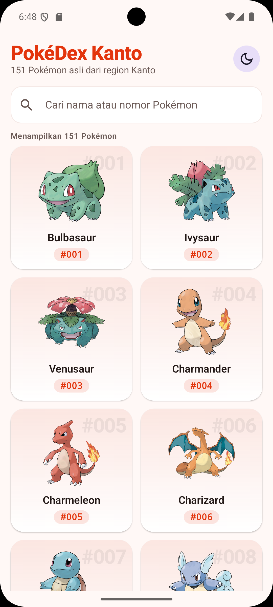
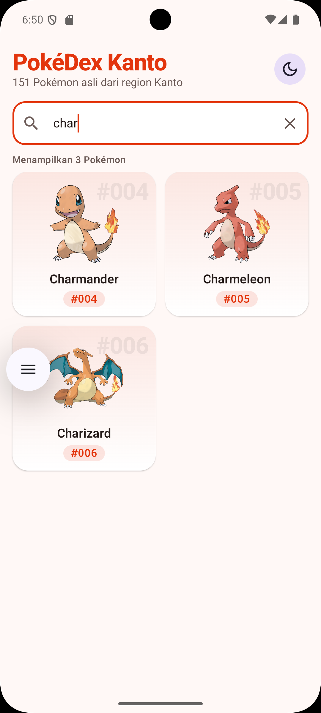
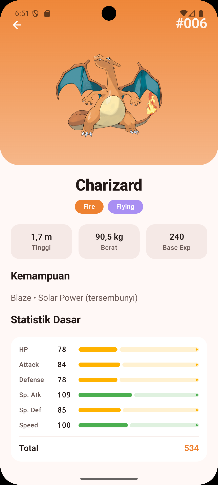
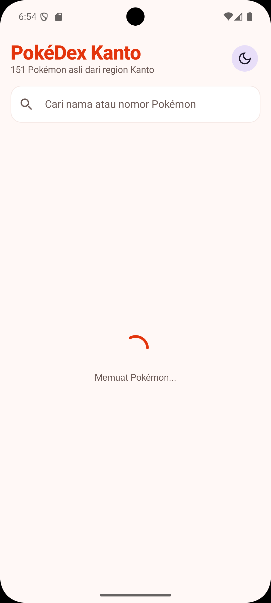
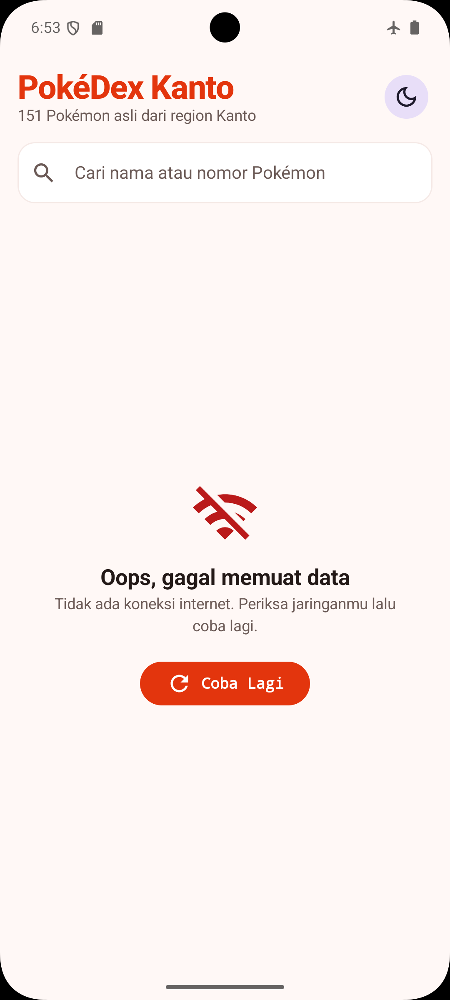
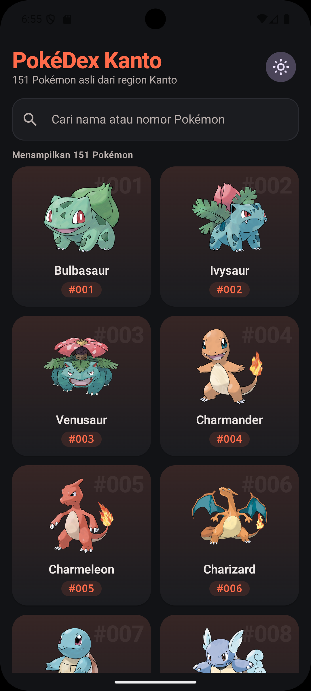
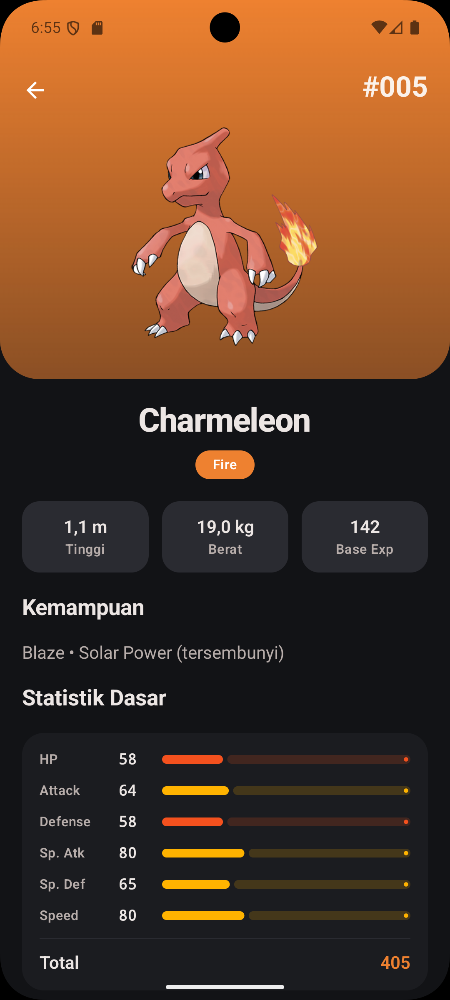

# PokéDex Kanto
> Katalog dan eksplorasi 151 Pokémon asli region Kanto, langsung dari PokéAPI.

---

## 👤 Identitas Praktikan
- **Nama Lengkap:** Ahmad Fikri Zakaria
- **NIM:** H1D024062
- **Shift Awal:** Shift B
- **Shift Akhir:** Shift C
- **Link Video Penjelasan:** [YouTube](https://youtu.be/LINK_VIDEO)

---

## 📱 Deskripsi Aplikasi
Pokémon punya banyak karakter dengan tipe, kemampuan, dan statistik yang berbeda-beda, sehingga sulit dihafal. **PokéDex Kanto** membantu pengguna mencari dan melihat informasi Pokémon generasi pertama (region Kanto, #001 Bulbasaur sampai #151 Mew) lewat HP.

Data diambil secara dinamis dari **PokéAPI**. Pengguna bisa melihat daftar Pokémon dalam bentuk grid, mencari berdasarkan nama atau nomor, lalu membuka halaman detail berisi tipe, tinggi, berat, kemampuan, dan statistik dasar. Target penggunanya pemain dan penggemar Pokémon yang ingin referensi cepat.

---

## 🛠️ Penjelasan Teknis

### 1. Spesifikasi & Tech Stack
- **Bahasa:** Kotlin 2.2.10
- **UI Framework:** Jetpack Compose (Material 3)
- **Min SDK:** 29 (Android 10) | **Target SDK:** 37
- **Pola Arsitektur:** MVVM (Model-View-ViewModel) + Repository
- **Library Utama:**
  - `Navigation Compose` 2.9.7: routing Home → Detail dengan argumen `pokemonId`
  - `ViewModel` & `StateFlow`: state management
  - `Retrofit` 3.0.0 + `Gson Converter`: networking ke REST API
  - `Coil` 2.6.0: memuat gambar Pokémon dari URL
  - `Kotlin Coroutines`: pemanggilan API secara asynchronous (`suspend` + `viewModelScope`)
  - `Material Icons Extended`: ikon search, tema, error, dll.

### 2. Fitur Utama
- **Daftar Pokémon (Home):** `LazyVerticalGrid` 2 kolom menampilkan gambar, nama, dan nomor 151 Pokémon. Setiap item memakai `key = id` sehingga Compose hanya menggambar ulang item yang berubah saat daftar difilter.
- **Pencarian:** teks di search bar disimpan di `PokemonListViewModel` sebagai `StateFlow`. Dengan operator `combine`, daftar hasil API digabung dengan kata kunci lalu difilter oleh extension function `List<Pokemon>.filterByQuery()`. Bisa cari nama ("pika") atau nomor ("25" / "#025"). Setiap huruf yang diketik memicu recomposition grid.
- **Loading, Error, dan Empty state:** UI memakai `sealed interface` (`Loading`, `Success`, `Error`). Saat memuat tampil `CircularProgressIndicator`; saat gagal (misalnya tanpa internet) tampil pesan yang ramah + tombol **Coba Lagi**; saat pencarian kosong tampil "Pokémon tidak ditemukan".
- **Detail Pokémon:** menampilkan gambar official artwork, nama, nomor, chip tipe, tinggi (m), berat (kg), base experience, kemampuan, dan 6 statistik dasar dengan progress bar beranimasi beserta totalnya. Warna header mengikuti tipe utama Pokémon.
- **Tema Gelap/Terang:** awalnya mengikuti tema HP, lalu bisa diganti lewat tombol di header. State tema disimpan dengan `rememberSaveable` sehingga tidak hilang saat layar diputar.

### 3. Arsitektur (MVVM)
```text
 Composable (View)          ViewModel                 Repository              Retrofit / API Service        PokéAPI
┌──────────────────┐  event  ┌────────────────────┐   ┌──────────────────┐    ┌───────────────────────┐   ┌──────────┐
│ HomeScreen       │ ──────► │ PokemonList        │──►│ PokemonRepository│───►│ PokeApiService        │──►│ /pokemon │
│ DetailScreen     │         │ PokemonDetail      │   │ (mapping data)   │    │ (RetrofitClient,      │   │          │
│ (components)     │ ◄────── │ StateFlow<UiState> │◄──│                  │◄───│  GsonConverter)       │◄──│  JSON    │
└──────────────────┘  state  └────────────────────┘   └──────────────────┘    └───────────────────────┘   └──────────┘
```
| Lapisan | File | Tugas |
|---|---|---|
| Data Model | `data/model/PokemonModels.kt`, `Pokemon.kt` | `data class` hasil parsing JSON + model untuk UI |
| API Service | `data/network/PokeApiService.kt` | Interface Retrofit: `@GET("pokemon")`, `@GET("pokemon/{idOrName}")` |
| Retrofit | `data/network/RetrofitClient.kt` | Singleton `object` + `by lazy`, base URL + `GsonConverterFactory` |
| Repository | `data/repository/PokemonRepository.kt` | Satu-satunya sumber data bagi ViewModel. Melengkapi id dan URL gambar |
| ViewModel | `ui/viewmodel/PokemonListViewModel.kt`, `PokemonDetailViewModel.kt` | Memanggil repository di `viewModelScope`, menyimpan `UiState` di `StateFlow` |
| View | `ui/screens/`, `ui/components/` | Hanya membaca state (`collectAsState`) dan mengirim event. Tidak ada pemanggilan API di Composable |

### 4. API yang Digunakan
Base URL: `https://pokeapi.co/api/v2/` (tanpa API key)

| Endpoint | Dipakai di | Data yang diambil |
|---|---|---|
| `GET /pokemon?limit=151&offset=0` | Home | `name`, `url` |
| `GET /pokemon/{id}` | Detail | `id`, `name`, `height`, `weight`, `base_experience`, `types`, `stats`, `abilities`, `sprites` |

Catatan implementasi:
- Endpoint daftar **tidak** mengirim id dan gambar. Id diambil dari `url` dengan extension function `String.extractPokemonId()` (`.../pokemon/25/` → `25`), lalu URL gambar dibuat dengan `Int.toArtworkUrl()`.
- `height` dalam desimeter dan `weight` dalam hektogram, sehingga dibagi 10 menjadi meter dan kilogram (`decimetersToMeters()`, `hectogramsToKilograms()`).
- Gambar detail memakai null safety berantai: `officialArtwork?.frontDefault ?: frontDefault ?: id.toArtworkUrl()`.

### 5. Penerapan Konsep Kotlin & Compose
| Syarat | Penerapan |
|---|---|
| Data class | Semua model di `data/model/`, `copy()` di `PokemonListViewModel` |
| Null safety | `baseExperience: Int?`, `sprites.other?.officialArtwork?.frontDefault`, `?:`, `toIntOrNull()` |
| Lambda | `onPokemonClick: (Int) -> Unit`, `onRetry`, `map { }`, `filter { }`, `joinToString { }` |
| Extension function | `util/Extensions.kt` (`extractPokemonId`, `toPokedexNumber`, `toDisplayName`, `filterByQuery`, dll.) dan `String.toTypeColor()` |
| Composable layout | `Column`, `Row`, `Box`, `Scaffold`, `Card` |
| Lazy layout | `LazyVerticalGrid(GridCells.Fixed(2))` dengan `key` |
| Reusable composable | `PokemonCard`, `PokemonSearchBar`, `TypeChip`, `StatBar`, `InfoBox`, `LoadingView`, `ErrorView`, `EmptyView` |
| Material 3, Theme, Typography | `ui/theme/` (color scheme terang & gelap, `Typography` kustom) |
| State & recomposition | `StateFlow` + `collectAsState`, `rememberSaveable`, `LaunchedEffect`, `animateFloatAsState` |

### 6. Struktur Direktori Proyek
```text
app/src/main/java/com/example/pokedexkanto/
├── data/
│   ├── model/        # PokemonModels.kt (DTO API), Pokemon.kt (model UI)
│   ├── network/      # PokeApiService.kt, RetrofitClient.kt
│   └── repository/   # PokemonRepository.kt
├── ui/
│   ├── components/   # PokemonCard, PokemonSearchBar, TypeChip, StatBar, InfoBox, StateViews
│   ├── navigation/   # PokedexNavHost.kt (route home & detail/{pokemonId})
│   ├── screens/      # HomeScreen.kt, DetailScreen.kt
│   ├── theme/        # Color.kt, Type.kt, Theme.kt
│   └── viewmodel/    # PokemonListViewModel.kt, PokemonDetailViewModel.kt
├── util/             # Constants.kt, Extensions.kt
└── MainActivity.kt
```

---

## 📸 Tangkapan Layar (Screenshots)

| Home | Pencarian | Detail |
|:---:|:---:|:---:|
|  |  |  |

| Loading | Error | Tema Gelap (Home) | Tema Gelap (Detail) |
|:---:|:---:|:---:|:---:|
|  |  |  |  |

---

## 🚀 Cara Menjalankan Proyek

1. **Prasyarat:**
   - Android Studio versi terbaru.
   - JDK 17 atau lebih baru.
   - Perangkat fisik Android 10+ dengan USB Debugging aktif atau Emulator, terhubung ke internet.

2. **Langkah:**
   ```bash
   # Clone repository
   git clone https://github.com/AhmadFikriZakaria/H1D024062-Responsi-Pemmob-Kotlin.git
   ```
3. Buka folder proyek di **Android Studio**.
4. Tunggu proses **Gradle Sync** selesai.
5. Pilih target perangkat/emulator, lalu klik tombol **Run (`Shift + F10`)**.
